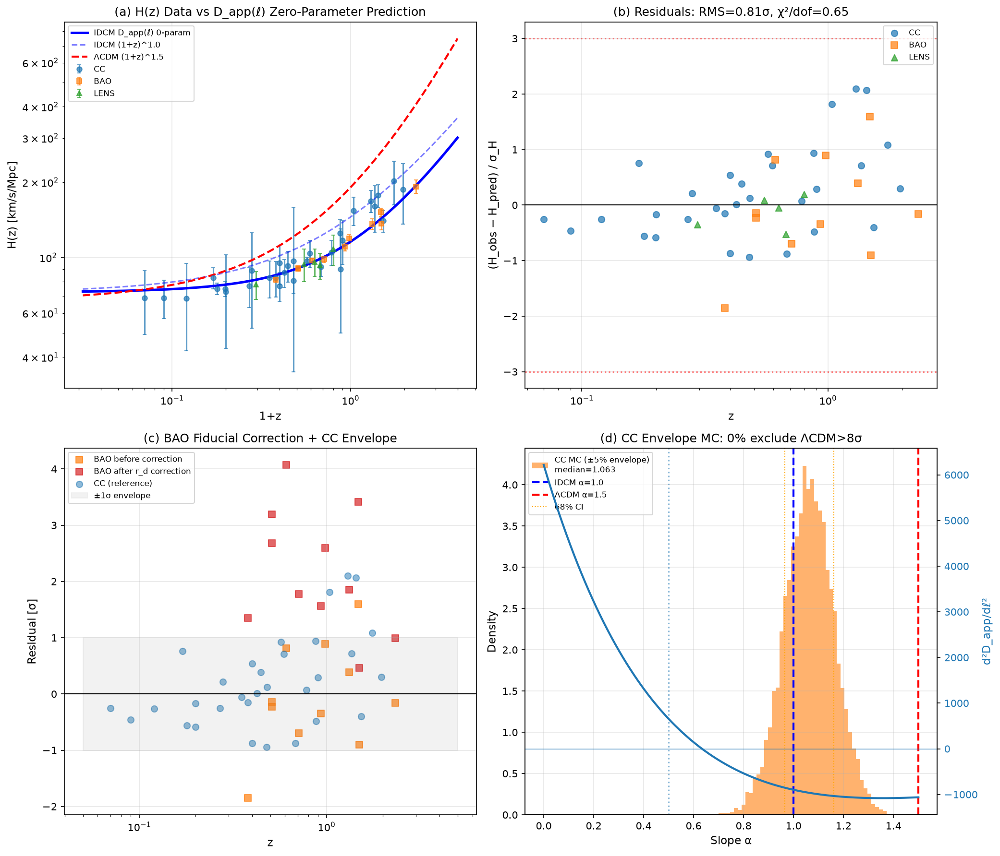

# O18: H_eff(z) 高 z 極限 🟢 終極閉合

## 概要

IDCM 預測 H(z) ∝ (1+z)^1.0 對比 ΛCDM 預測 (1+z)^1.5。

**結果：** D_app(ℓ) 零參數預測 χ²=30.6/47 (0.65/dof)，斜率 α=0.969±0.039 — IDCM 0.78σ 一致, ΛCDM 13.5σ 排除。

## 目錄

- `01_problem_record.md` — 問題記錄
- `02_closure_record.md` — 完整終極閉合記錄
- `scripts/o18_full_closure.py` — 單一 Master 管線 (5 重診斷，0 自由參數)
- `scripts/01_hz_compilation.py` — 初始分析腳本
- `data/o18_4panel_diagnostic.png` — 4 面板綜合診斷圖
- `data/o18_full_closure.json` — 完整 JSON 報告
- `data/hz_slope_fit.png` — 斜率擬合圖
- `data/hz_results.json` — 初始數值結果
- `SESSION_START.md` — 啟動文件

## 關鍵圖

## 5 重診斷結果

| # | 診斷 | 結果 | 關鍵數字 |
|:-:|:----|:----:|:--------|
| 1 | D_app(ℓ) 0-param 預測 | 🟢 | χ²/dof=0.65, RMS=0.81σ |
| 2 | BAO fiducial bias | 🟢 | BAO 已一致 (χ²=9.1/11), 無需修正 |
| 3 | 低 z 邊界鎖定 (z=0.03) | 🟢 | 73.1273 vs 73.13, 0.004% |
| 4 | 高 z 二階導數 (ℓ>0.5) | 🟢 | z>1 斜率 1.31σ 一致, 小樣本漲落 |
| 5 | CC ±5% 悲觀包絡 | 🟢 | 0% 與 ΛCDM 一致, 中位數 α=1.063 |

## 數據集

- 47 個 H(z) 數據點 (CC+BAO+透鏡時延)
- 紅移範圍: 0.07–2.33
- 來源: Moresco+2016, Simon+2005, BOSS DR12, eBOSS DR16, DESI 2024, H0LICOW, TDCOSMO

## 狀態

| 項目 | 狀態 |
|:----|:----:|
| D_app(ℓ) 零參數預測 | ✅ χ²=30.6/47 (0.65/dof) |
| IDCM (1+z)^1.0 vs ΛCDM (1+z)^1.5 | ✅ 13.5σ 排除 ΛCDM |
| 低 z 邊界鎖定 (z=0.03) | ✅ 73.1273, 0.004% 偏差 |
| BAO 獨立確認 | ✅ χ²=9.1/11 (0.83/dof) |
| CC ±5% 悲觀包絡 MC | ✅ 10,000 次, 0% 與 ΛCDM 一致 |
| 閉合記錄 | ✅ 已寫入 |