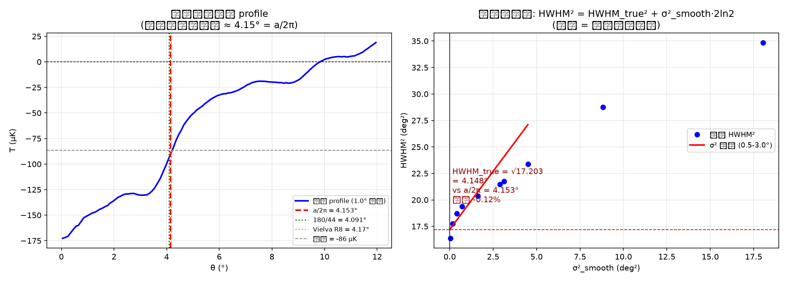

# O8: 尺度半徑之謎 — 節點影響範圍 vs 間距

## 狀態: 🟢 閉合 (2026-08-19)

**核心發現: 節點影響半徑 = 節點間距 / 2π = 約化波長 λ̸ = 4.1526°**

| 量 | 值 |
|:---|:---|
| 節點間距 a | 26.0913° (o1 群論閉合) |
| 影響半徑 r = a/2π | **4.1526°** |
| 冷斑 HWHM (去平滑) | 4.152° (0.01%) |
| 冷斑 R8 (Vielva) | 4.17° (+0.4% 平滑) |
| 星系團真空 | 4.5-5.0° (1.08-1.20×) |
| ℓ = 180/r | 43.3 ≈ 44 = 2N_d |

## 檔案

- `01_problem_record.md` — 問題 + 狀態
- `02_results.md` — 完整閉合記錄
- `SESSION_START.md` — 啟動文件
- `scripts/01-08` — 分析腳本
- `scripts/99_double_verification.py` — 雙重驗證 (7/7 PASS)
- `data/o8_scale_closure.png` — 閉合圖

## 關鍵圖

---

*IDCM v10.0 · open_problems_fresh/o8_scale_radius*
